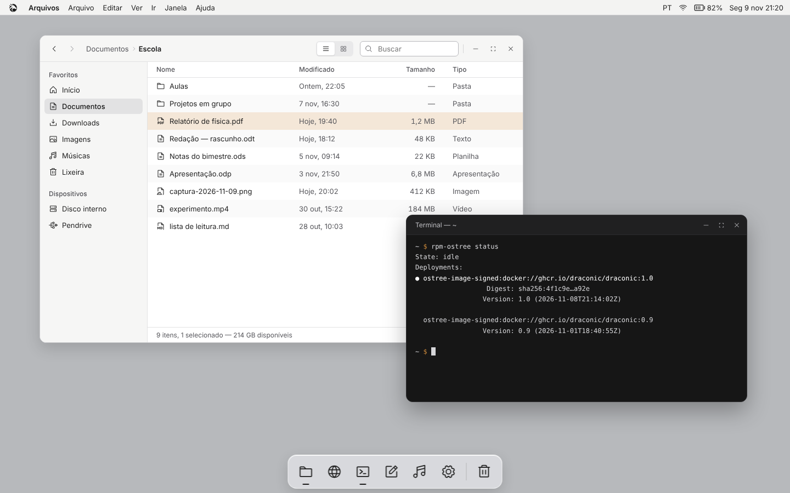
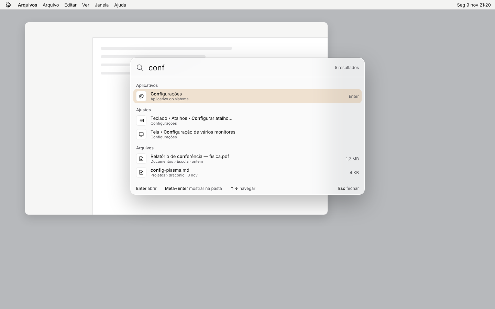
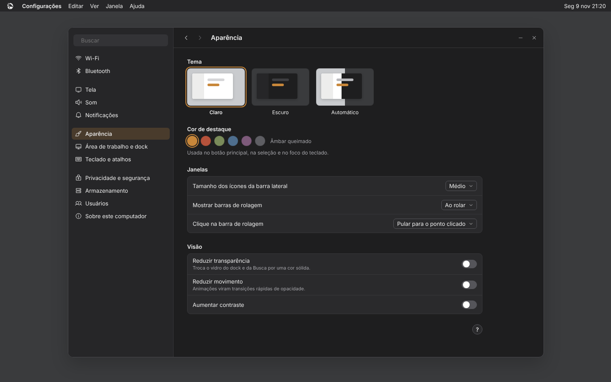
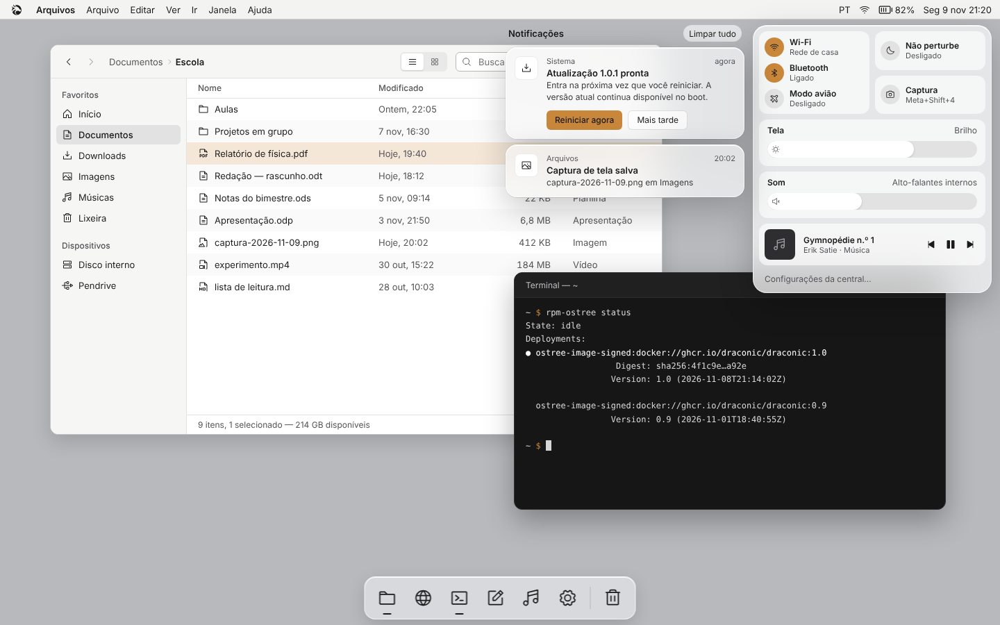
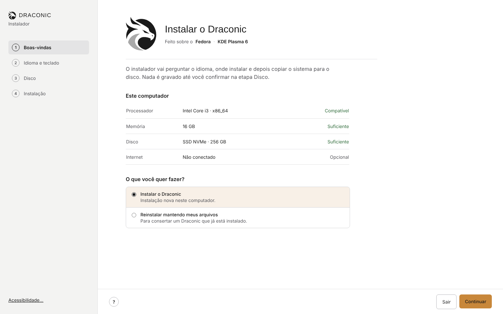

# Draconic

Sistema operacional para PC baseado no **Fedora Kinoite** (Fedora Atomic com KDE Plasma 6). A ergonomia do macOS — barra superior com menu global, dock, busca com Meta+Espaço, atalhos consistentes — com identidade própria e sem visual genérico.

> Status: **design pronto, construção começando.** A imagem do sistema ainda não existe.

## O que tem aqui

| Caminho | Conteúdo |
|---|---|
| `CLAUDE.md` | Instruções para o agente de programação: ambiente, regras e fases |
| `docs/prompt-construcao.md` | O prompt para colar no Claude Code e começar |
| `docs/design-system.md` | Cores (claro e escuro), tipografia, espaço, componentes, movimento, atalhos e o que o sistema não faz |
| `docs/telas.md` | Catálogo de todas as telas, como cada uma vira Plasma e o que é viável agora |
| `design/telas/` | Imagens de referência de todas as telas |
| `design/prototipo/` | Código das telas (HTML) para tirar valores exatos |
| `assets/logo/` | Logo completo e marca reduzida, em SVG |

## Decisões principais

- **Base:** Fedora Kinoite, imagem construída com BlueBuild e instalada com `rpm-ostree rebase`.
- **Arquiteturas:** x86_64 (com variante NVIDIA) e aarch64 (máquinas virtuais em Mac com chip Apple).
- **Fontes:** IBM Plex Sans e IBM Plex Mono; Michroma só no nome "DRACONIC".
- **Ícones:** Phosphor, peso regular, sem misturar.
- **Cor de destaque:** âmbar queimado (`#C8873A` claro, `#D99A4E` escuro).
- **Temas:** claro e escuro, dos mesmos tokens.

## Algumas telas

| | |
|---|---|
|  |  |
|  |  |

## Aviso

Draconic é um projeto independente baseado no Fedora. Não é um produto oficial do Projeto Fedora.
